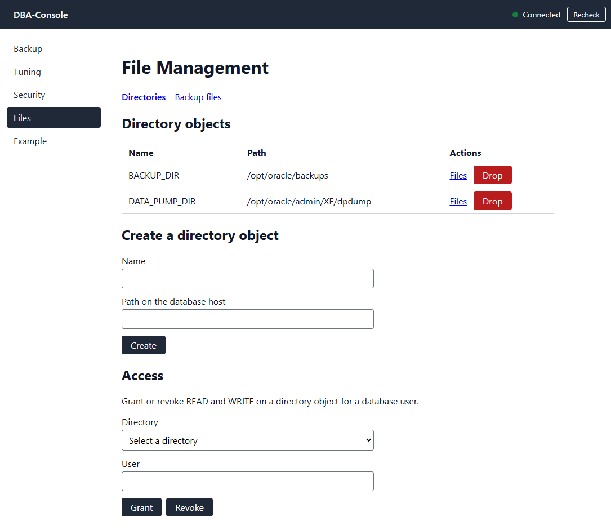
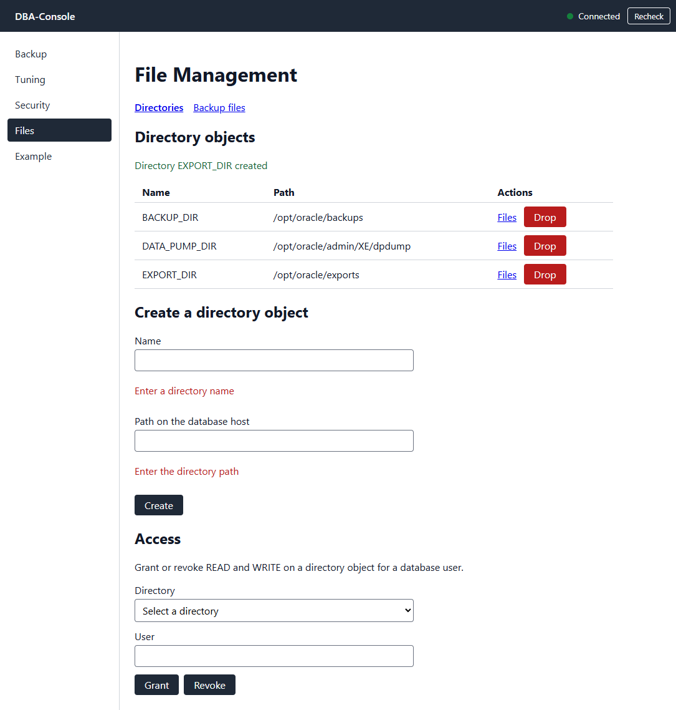
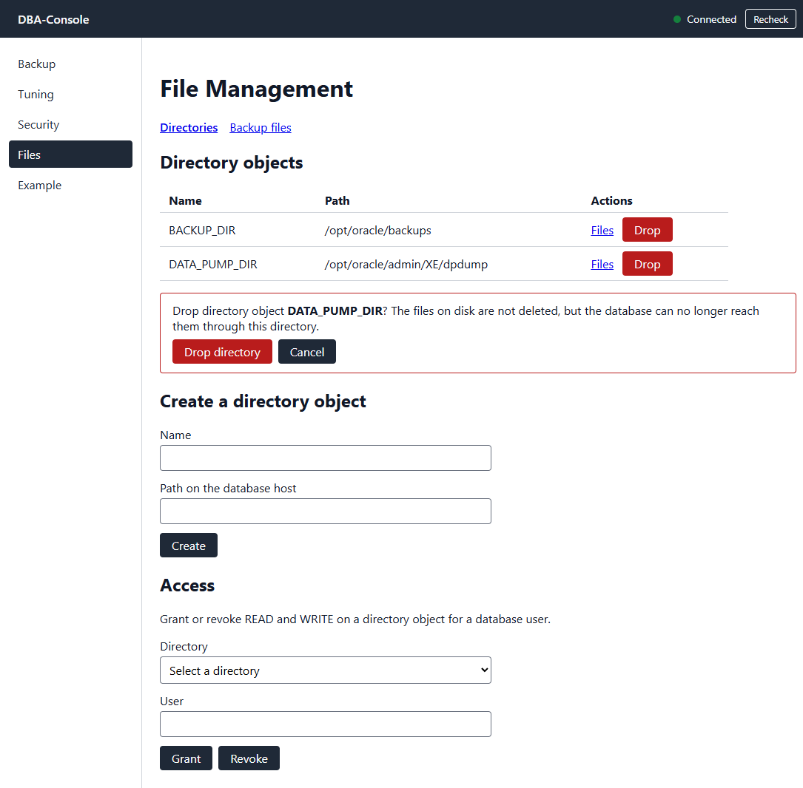
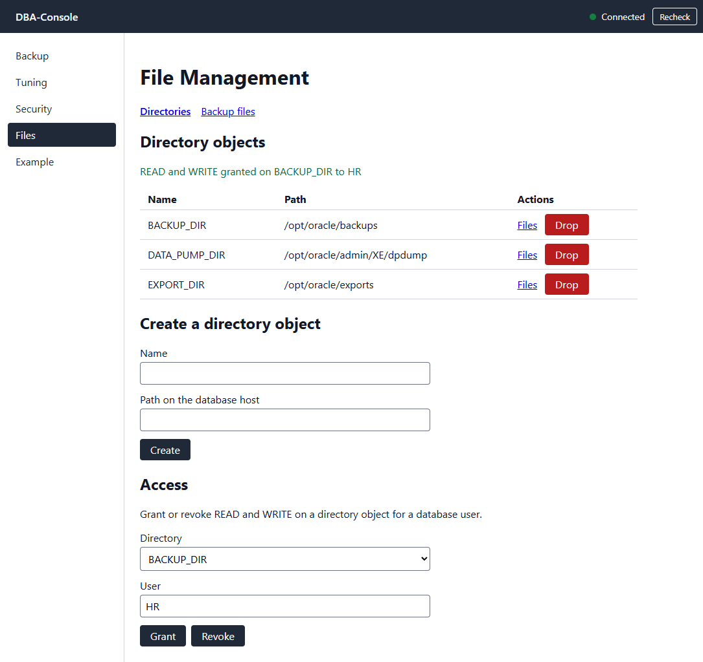
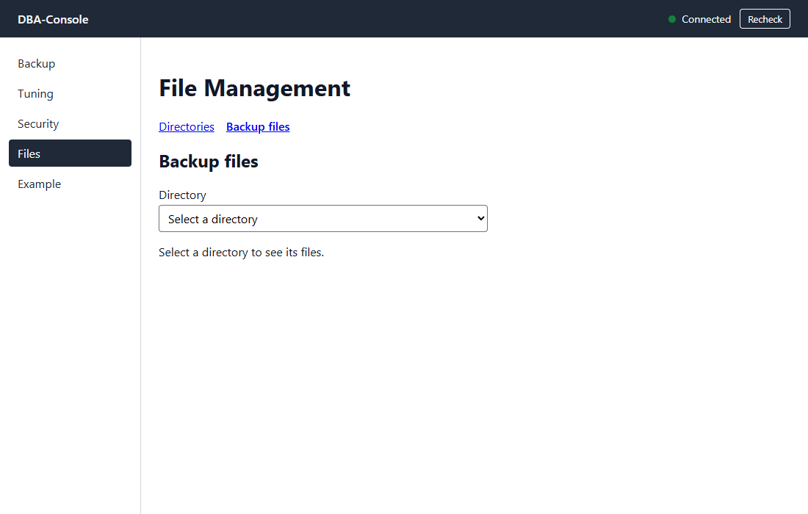
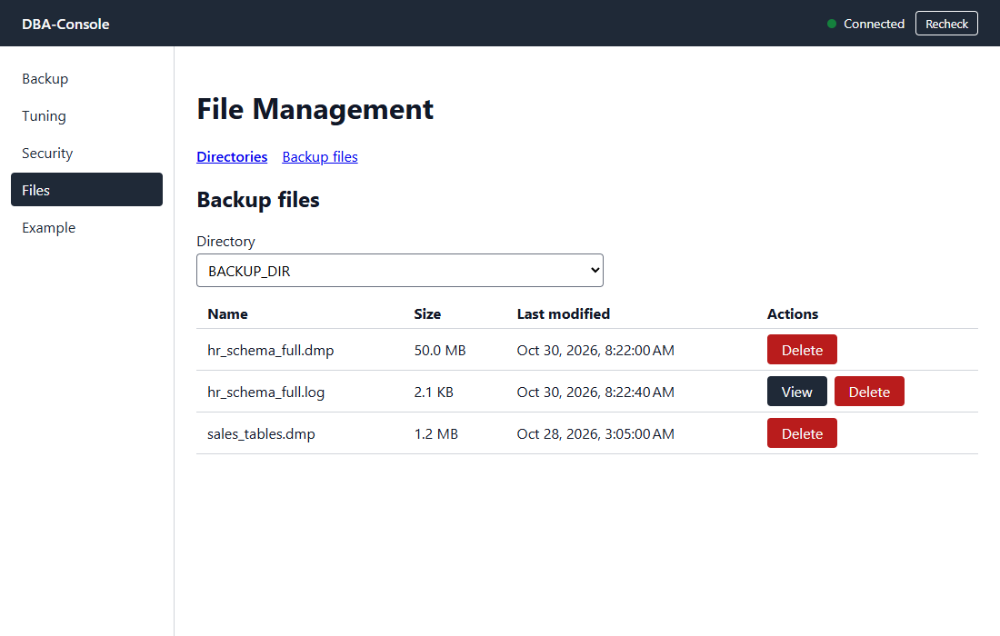
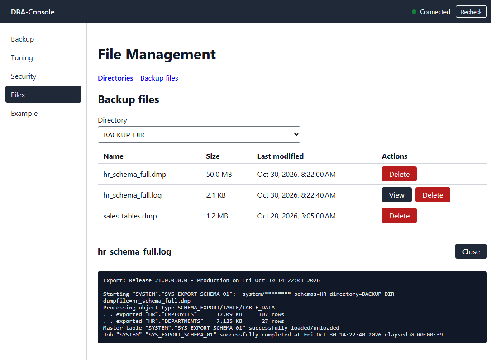
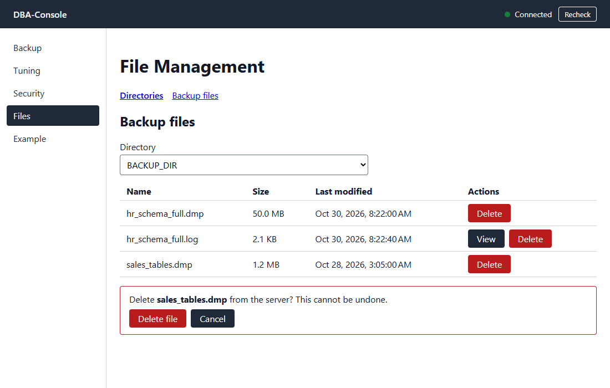

# DBA-Console User Manual

This manual explains how to use the DBA-Console web interface. At this stage only the **File Management** module is available; the Backup, Tuning, and Security pages are placeholders and show "This module is not implemented yet."

> The screenshots use sample data (directory objects such as `BACKUP_DIR` and the files inside them). Your names, paths, and sizes will differ.

## Contents

1. [Before you start](#before-you-start)
2. [The main window](#the-main-window)
3. [File Management: Directories](#file-management-directories)
4. [File Management: Backup files](#file-management-backup-files)
5. [Messages and troubleshooting](#messages-and-troubleshooting)

## Before you start

- The backend must be running and able to reach the Oracle database. See the [README](../README.md) for configuration and startup.
- Start the frontend from the `frontend/` folder with `npm start`, then open <http://localhost:4200>.
- The files shown in File Management live on the **database server**, not on your computer. Paths you type are paths on that server.

## The main window

The window has three areas:

- **Header**: the application name and the connection indicator. *Connected* (green) means the backend can reach the database. *Disconnected* means it cannot; hover over the indicator to see the reason. Press **Recheck** to test again. The indicator also refreshes itself every 30 seconds.
- **Side menu**: Backup, Tuning, Security, Files, and Example. The current module is highlighted.
- **Content area**: the screen of the selected module.

Open **Files** in the side menu to reach File Management. It has two tabs, **Directories** and **Backup files**.

## File Management: Directories

Open **Files → Directories**. This screen manages Oracle *directory objects*: named pointers from the database to a folder on the server. Data Pump exports write their `.dmp` and `.log` files into these folders.

### Review the existing directories

The **Directory objects** table lists each directory's **Name** and **Path**. If none exist, the screen says so and you can create one below.

### Create a directory object

1. In **Name**, type the directory object name (for example `EXPORT_DIR`).
2. In **Path on the database host**, type the absolute folder path on the database server (for example `/opt/oracle/exports`).
3. Press **Create**.

The new directory appears in the table and a green confirmation message is shown above it. If a field is empty or invalid, a red message appears under that field and nothing is created.

> Creating a directory object does not create the folder on disk. The folder must already exist on the database server.

### Drop a directory object

1. Press **Drop** on the row you want to remove.
2. A confirmation box appears. Read it, then press **Drop directory** to continue or **Cancel** to keep it.

Dropping removes only the directory object. The files on disk are **not** deleted, but the database can no longer reach them through that directory.

### Grant or revoke access

The **Access** section controls which database users can read and write in a directory.

1. Choose the **Directory** from the list.
2. Type the database **User** (for example `HR`).
3. Press **Grant** to give the user READ and WRITE, or **Revoke** to remove them.

A confirmation message is shown after each action.

## File Management: Backup files

Use this screen to see the `.dmp` (dump) and `.log` files inside a directory, read export logs, and remove files you no longer need. There are two ways in:

- From **Directories**, press **Files** on a row. The directory is already selected.
- Open the **Backup files** tab and choose a directory from the **Directory** list.

Until you choose a directory the screen shows "Select a directory to see its files."

### Review the files

The table lists each file's **Name**, **Size**, and **Last modified** date. Only `.dmp` and `.log` files are shown. If there are none, the screen says "This directory has no .dmp or .log files."

### Read a log

Log files have a **View** button. Press it to open the log below the table. If the file is large, only its beginning is shown and a warning says so. Press **Close** to hide it.

### Delete a file

1. Press **Delete** on the file's row.
2. Confirm with **Delete file**, or press **Cancel** to keep it.

**Deleting removes the file from the server and cannot be undone.** Make sure you have another copy of any backup you still need.

## Messages and troubleshooting

| What you see | What it means | What to do |
|---|---|---|
| Green message after an action | The operation succeeded. | Nothing. |
| Red message above or under a field | The operation failed or the input is invalid. The text comes from the server. | Read the message and correct the input. |
| "Cannot reach the server. Check that the backend is running." | The frontend cannot contact the backend. | Start the backend, then press **Recheck**. |
| Header shows *Disconnected* | The backend is up but cannot reach Oracle. | Check `DB_URL`, `DB_USER`, and `DB_PASS`, and that the database is running. |
| "Loading..." stays on screen | The request is still in progress or was interrupted. | Wait a few seconds, then reload the page. |
