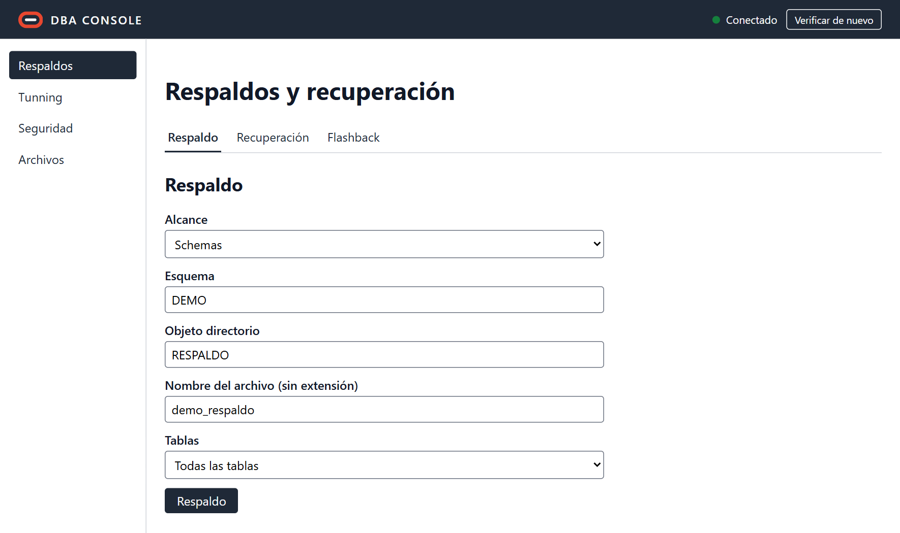
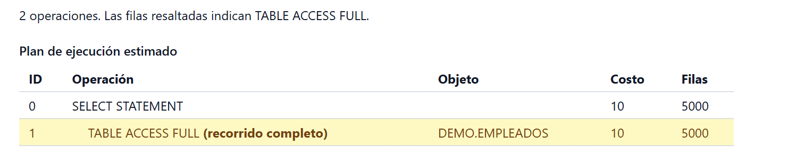
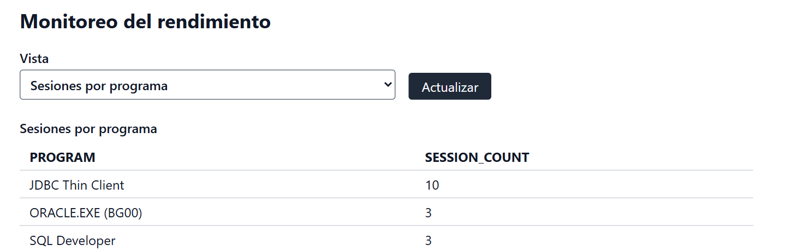
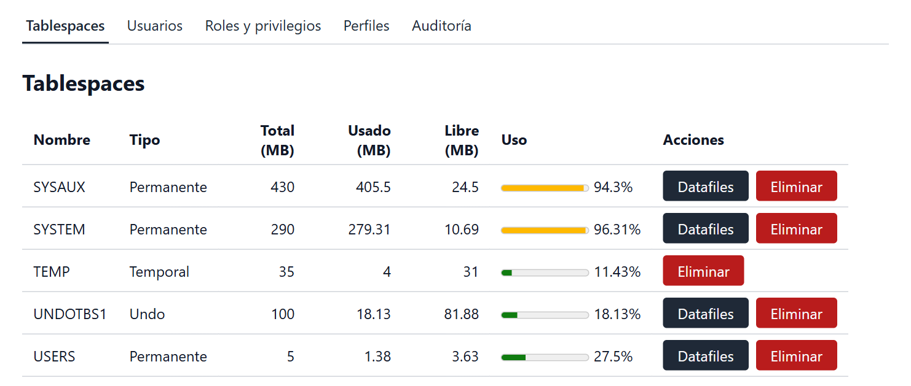
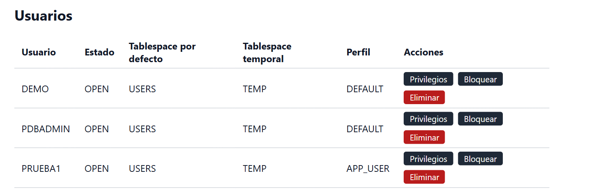
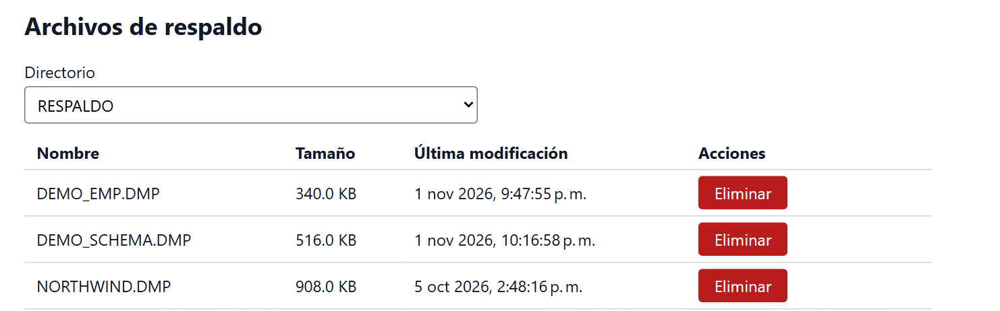

# Manual de usuario de DBA Console

DBA Console es una aplicación web para administrar Oracle Database 21c Express Edition: respaldos, tunning, seguridad y archivos. Las capturas se tomaron contra una base de datos real; los nombres `DEMO` y `RESPALDO` son ejemplos.

## Antes de empezar

**Requisitos:** Oracle Database 21c XE, JDK 17 o superior y Node.js con npm. La aplicación debe ejecutarse en el mismo equipo que la base de datos, con `expdp` e `impdp` disponibles en el `PATH`.

1. Copie `.env.example` como `.env` en la raíz del proyecto y complete `DB_URL` (servicio `XEPDB1`), `DB_USER`, `DB_PASS` y `DATAFILE_DIR`. En Windows, escriba las rutas con barras normales (`C:/...`).
2. Inicie el backend desde la raíz del proyecto: `.\mvnw.cmd spring-boot:run` (en Linux, `./mvnw spring-boot:run`).
3. En otra terminal, inicie el frontend: `cd frontend`, `npm install` y `npm start`.
4. Abra <http://localhost:4200>.

## La ventana principal

- **Encabezado:** muestra *Conectado* si el backend alcanza la base de datos, o *Desconectado* si no; pase el cursor sobre el indicador para ver el motivo. Se actualiza cada 30 segundos o al pulsar **Verificar de nuevo**.
- **Menú lateral:** **Respaldos**, **Tunning**, **Seguridad** y **Archivos**. Cada módulo se divide en pestañas.
- **Mensajes:** en verde si la operación terminó bien y en rojo si falló. Los errores incluyen el motivo que devuelve Oracle.
- **Confirmaciones:** las acciones destructivas piden confirmación antes de ejecutarse.

## Respaldos

### Respaldo

Crea una exportación con Data Pump (`expdp`).

1. En **Alcance**, elija **Schemas**, **Tablas** o **Full** (toda la base de datos).
2. Complete **Esquema** y **Tabla** si se piden, el **Objeto directorio** donde se guardará y el **Nombre del archivo**, sin extensión.
3. En **Schemas** y **Full**, la lista **Tablas** permite incluir o excluir tablas; escriba sus nombres separados por comas.
4. Pulse **Respaldo** y mantenga la página abierta. Al terminar se muestran el comando y la salida; **Ver log** abre el archivo de log.

### Recuperación

Restaura un respaldo con `impdp`, con los mismos campos. Si la tabla o el esquema ya existe, la operación se rechaza: elimínelo antes de recuperarlo.

> **Full** sobrescribe toda la base de datos y exige marcar una casilla de confirmación. No la use en una demostración.

### Flashback

- **Flashback de tabla:** indique **Esquema** y **Tabla** y pulse **Restaurar tabla** para recuperarla de la papelera de reciclaje.
- **Consulta flashback:** indique también **Fecha y hora**. **Ver filas** muestra las filas de ese momento (hasta 100) y **Restaurar filas faltantes** inserta las que ahora no están.

## Tunning

### Plan de ejecución

Escriba una sentencia SQL y pulse **Generar plan**. La sentencia no se ejecuta: el plan es una estimación. Las filas resaltadas indican un recorrido completo de la tabla (`TABLE ACCESS FULL`).

### Estadísticas e índices

1. Escriba el **Esquema** y pulse **Cargar estadísticas e índices**.
2. Pulse **Recopilar estadísticas** para actualizarlas: de la tabla si completó **Tabla**, o de todo el esquema si no.
3. En **Crear índice**, indique la tabla, el nombre, las columnas separadas por comas y el tipo (**Árbol B** o **Bitmap**).
4. En cada índice puede usar **Reconstruir**, **Validar estructura** o **Eliminar**.

### Monitoreo

Elija una **Vista** (estado de la instancia, parámetros, sesiones, bloqueos u objetos bloqueados) y pulse **Actualizar** para refrescarla. En **Bloqueos**, **Terminar sesión bloqueadora** cierra la sesión que retiene el bloqueo, tras confirmar; Oracle revierte el trabajo no confirmado de esa sesión.

## Seguridad

### Tablespaces

La tabla muestra el tipo y el uso de espacio de cada tablespace.

- **Crear:** en **Crear un tablespace**, elija **Permanente** o **Temporal**, el nombre, el archivo y los tamaños. El archivo se crea en `DATAFILE_DIR`.
- **Datafiles:** muestra los archivos de un tablespace y permite redimensionarlos o agregar otro. Este botón no aparece en los temporales.
- **Eliminar:** Oracle rechaza la eliminación del tablespace temporal por defecto de la base de datos.

### Usuarios

Lista los usuarios creados por administradores; los de Oracle, como `SYS` y `SYSTEM`, no aparecen.

- **Crear un usuario:** indique nombre, contraseña, tablespaces, perfil y cuota. Un usuario nuevo no puede iniciar sesión hasta tener el privilegio `CREATE SESSION`.
- **Privilegios:** abre los permisos de ese usuario. **Bloquear** o **Desbloquear** cambia el estado de la cuenta.
- **Eliminar:** puede borrar también sus objetos si marca la opción `CASCADE`.

### Roles y privilegios

1. Escriba el **Usuario o rol** y pulse **Mostrar privilegios** para ver sus privilegios de sistema, roles y privilegios sobre objetos. Cada fila se puede revocar.
2. En **Otorgar**, elija en **Qué otorgar** un privilegio de sistema, un rol o privilegios sobre un objeto.
3. En **Roles**, cree o elimine roles propios. Los mantenidos por Oracle se pueden otorgar, pero no eliminar.

### Perfiles

En **Crear o modificar un perfil**, complete solo los límites que quiera establecer: un número entero, `UNLIMITED` o `DEFAULT`. Luego use **Asignar un perfil a un usuario**.

### Auditoría

El parámetro `audit_trail` debe valer `DB`; si no, la pantalla indica cómo activarlo, y el registro queda vacío hasta reiniciar la base de datos.

- **Auditoría de sesiones:** activa o desactiva el registro de inicios de sesión.
- **Auditoría de tablas:** indique propietario, tabla y acciones y pulse **Auditar tabla**. **Detener** la desactiva.
- **Registro de auditoría:** elija qué **Mostrar** y cuántas **Filas**, y pulse **Leer registro**.

## Archivos

### Directorios

Un objeto directorio es un nombre de Oracle que apunta a una carpeta del servidor. Los respaldos guardan allí sus archivos.

1. En **Crear un objeto directorio**, escriba el **Nombre** y la **Ruta** y pulse **Crear**. La carpeta debe existir: Oracle no la crea.
2. En **Acceso**, elija el **Directorio**, escriba el **Usuario** y pulse **Otorgar** o **Revocar** para dar o quitar `READ` y `WRITE`.
3. **Eliminar** borra el objeto directorio, pero no los archivos en disco.

### Archivos de respaldo

Elija un **Directorio** para ver sus archivos `.dmp` y `.log`, o pulse **Archivos** en una fila de **Directorios**. **Ver** abre un log. **Eliminar** borra el archivo del servidor y no se puede deshacer.

## Problemas frecuentes

| Qué ve | Qué hacer |
|---|---|
| Indicador en *Desconectado* | Compruebe que Oracle esté activo y revise `DB_URL`, `DB_USER` y `DB_PASS`. |
| "No se puede conectar con el servidor" | Inicie el backend y pulse **Verificar de nuevo**. |
| `ORA-00942: la tabla o vista no existe` | Revise el esquema y la tabla: no existen o el nombre está mal escrito. |
| Falla un respaldo o una recuperación | Compruebe que el objeto directorio exista, que su carpeta exista y que `expdp` e `impdp` estén en el `PATH`. |
